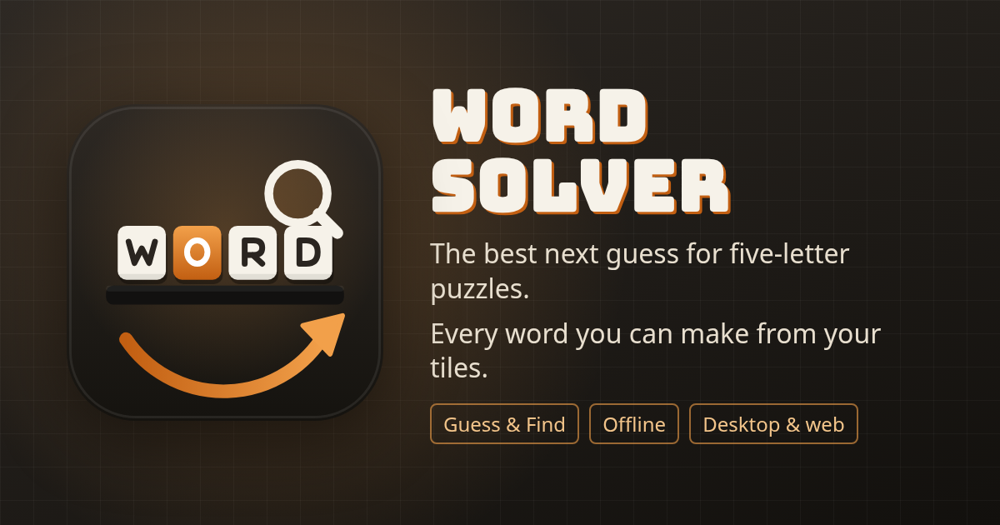
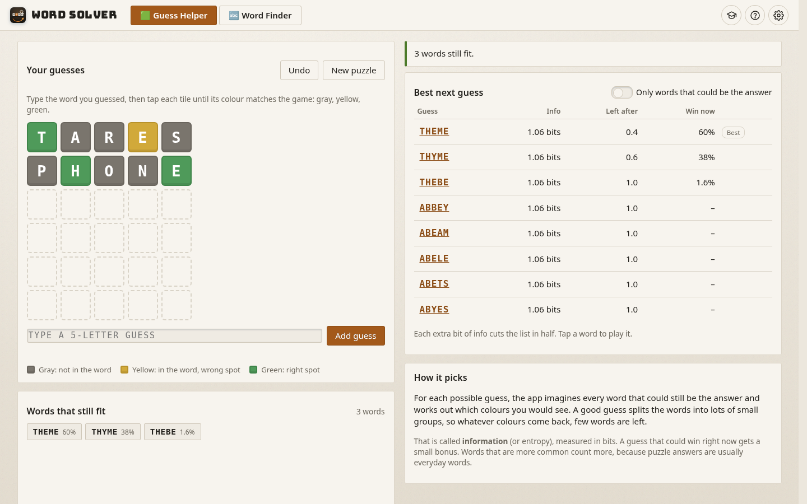
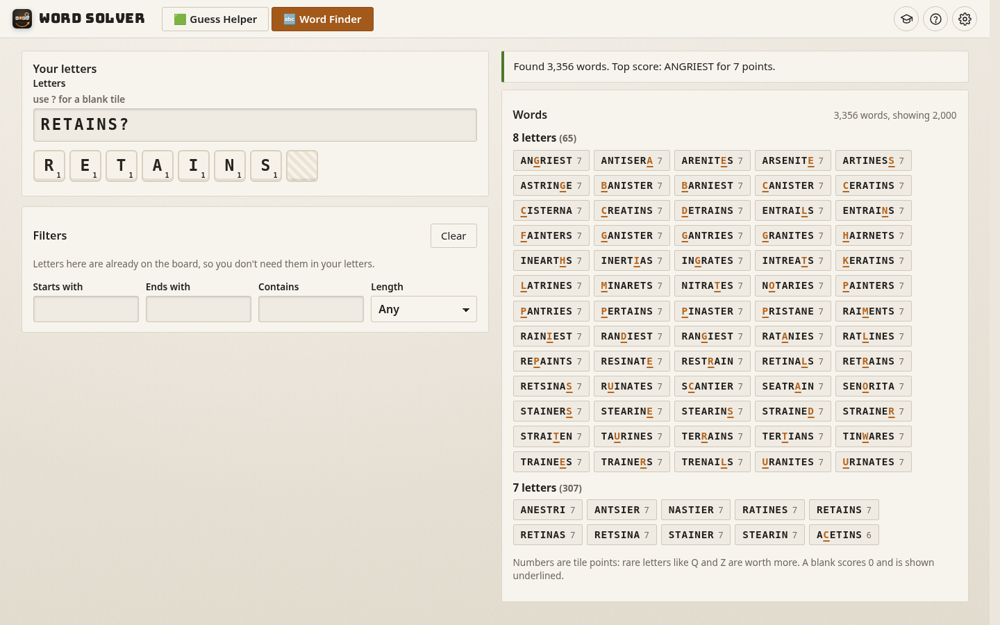
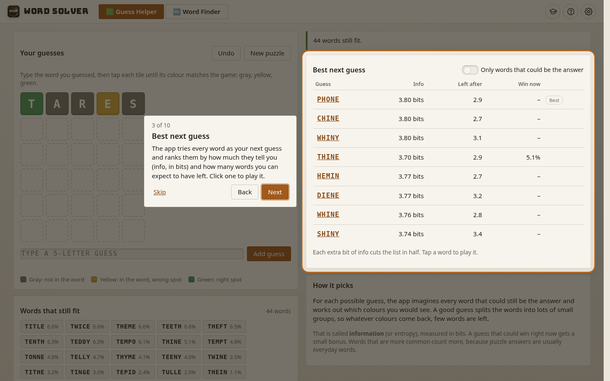
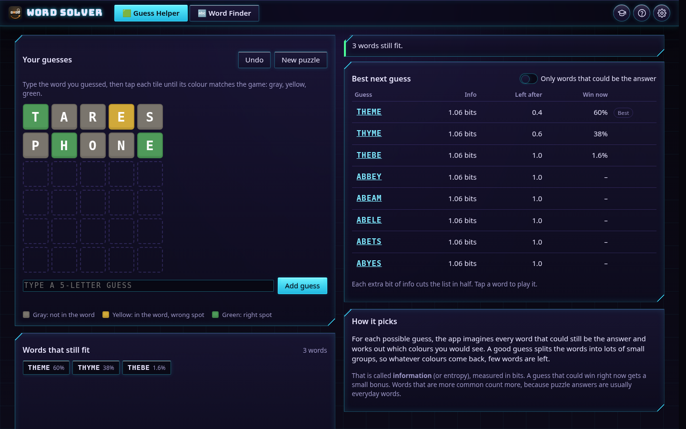

<p align="center"></p>

# Word Solver

Two helpers for word games, explained in plain words:

- **Guess Helper** for five-letter guessing games. Type the word you guessed, tap each tile until it shows the colour the game gave you (gray, yellow, green), and Word Solver lists every word that still fits and ranks the best next guess.
- **Word Finder** for letter-tile games. Type your letters (use `?` for a blank) and see every word you can make, longest first, with tile points. Add letters already on the board with *Starts with*, *Ends with* and *Contains*, or pick an exact length.

It runs in your browser, installs as an app (PWA), works offline, and comes as a Windows desktop app.

**Live demo:** [words.chafic.me](https://words.chafic.me)

| Guess Helper | Word Finder |
|---|---|
|  |  |
|  |  |

## How the Guess Helper thinks

1. **Colours.** For a guess and a possible answer, greens are marked first, then yellows left to right while copies of that letter are left; the rest are gray. So guessing SPEED when the answer is SHRED lights only one E. A word stays on the list only if it would have given *exactly* the colours you saw for every guess, which handles double letters correctly.
2. **Information.** For each possible next guess, the app works out which colours every remaining word would give and how the words split into groups. A guess that splits them into many small groups tells you more. This is measured in bits (entropy): each bit halves the list on average. The approach follows 3Blue1Brown's well-known lesson on the subject.
3. **Common words count more.** Puzzle answers are usually everyday words, so each word is weighted by how common it is in English (an S-curve on its wordfreq Zipf score). A guess that could win right now gets a small bonus.
4. The best first guesses are worked out ahead of time over all 8,636 five-letter words (`tools/gen-openers.ts`). After that the search runs live in a Web Worker; when the list is still huge, the guesses checked are pre-picked by how many common letters they test.

Tick **Only words that could be the answer** to play for a win now instead of for information.

## How the Word Finder works

The 172,823-word list is loaded into a letter tree (a trie) inside a Web Worker. The search walks the tree using only the letters you have, so it never checks words you can't make. A blank can become any letter and scores 0; it's shown underlined. Letters in the filters count as already on the board, so they don't use your tiles. The built tree is saved in your browser (IndexedDB), so later visits start instantly, and the word files are cached for offline use.

## Word lists and credits

- **Words:** the ENABLE word list (Enhanced North American Benchmark Lexicon), public domain. `public/data/enable.txt`.
- **Word frequencies:** [wordfreq](https://github.com/rspeer/wordfreq) by Robyn Speer, data licensed CC BY-SA 4.0. `public/data/words5.txt` lists each five-letter word with its Zipf frequency.
- **Title font:** Bungee, SIL Open Font License.
- Tile points are the classic letter values.

Word Solver is an independent project. It is not made by or connected with any word game or its makers, and it does not use any game's official word or answer list.

Rebuild the word data with `python3 tools/build-data.py` (needs `pip install wordfreq`), then `npx tsx tools/gen-openers.ts`.

## Run it

```bash
npm install
npm run dev        # http://localhost:5177
npm test           # unit tests
npm run lint
npm run build      # static site in dist/
npm run desktop    # Windows installers (needs Rust and Tauri)
```

### Deploy (Cloudflare Workers static assets)

```bash
SITE_URL=https://words.chafic.me npm run build
npx wrangler deploy
```

`wrangler.jsonc` has no routes; the custom domain is attached in the Cloudflare dashboard. `SITE_URL` makes the link-preview tags absolute. Every file stays well under Cloudflare's 25 MiB limit (the biggest is the 1.7 MB word list).

## Settings and tutorial

The gear opens Settings: four looks (Matte, Frutiger Aero, Neon, Neubrutalism), each in light and dark, following your computer by default (System). The desktop app also checks for updates there. The 🎓 button has five short lessons and a tour of the app with live examples; your own guesses and letters are put back afterwards.

## Built with

TypeScript, Vite, Web Workers, Vitest, ESLint and Tauri 2. MIT licence.
